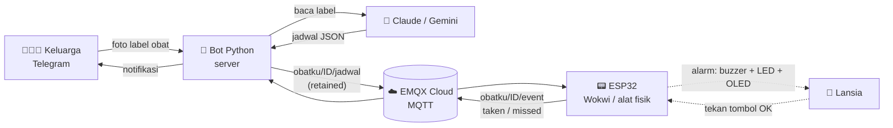

# 💊 SiMbah — Sistem Ingat Minum obat Berbasis Ai dan Hardware

> Pengingat minum obat untuk lansia. Keluarga cukup **memotret label obat** lewat Telegram, AI membaca jadwalnya, lalu alat **ESP32** berbunyi tepat waktu mengingatkan lansia menggunakan fitur Text-To-Speech pada alat IoT. Begitu obat diminum (atau terlewat), keluarga langsung mendapat notifikasi.

Proyek ini dibuat untuk **hackathon**. Alat dapat disimulasikan penuh di [Wokwi](https://wokwi.com), jadi tidak perlu hardware fisik untuk mencobanya.

---

## 📑 Daftar Isi

- [Cara Kerja](#-cara-kerja)
- [Fitur](#-fitur)
- [Struktur Repositori](#-struktur-repositori)
- [Prasyarat](#-prasyarat)
- [Langkah 1 — Buat Akun & Broker EMQX](#-langkah-1--buat-akun--broker-emqx)
- [Langkah 2 — Buat Bot Telegram & API Key AI](#-langkah-2--buat-bot-telegram--api-key-ai)
- [Langkah 3 — Setup Server Bot (Windows PowerShell + venv)](#-langkah-3--setup-server-bot-windows-powershell--venv)
- [Langkah 4 — Instalasi Alat di Wokwi](#-langkah-4--instalasi-alat-di-wokwi)
- [Langkah 5 — Uji Coba End-to-End](#-langkah-5--uji-coba-end-to-end)
- [Perintah Bot Telegram](#-perintah-bot-telegram)
- [Skema Rangkaian](#-skema-rangkaian)
- [Topik & Format Pesan MQTT](#-topik--format-pesan-mqtt)
- [Troubleshooting](#-troubleshooting)
- [Keamanan](#-keamanan)
- [Disclaimer](#-disclaimer)

---

## 🔄 Cara Kerja



1. Keluarga menghubungkan chat Telegram ke alat dengan `/start ID_ALAT`.
2. Keluarga mengirim **foto label obat**. AI (Claude atau Gemini) mengekstrak nama obat, dosis, aturan, dan frekuensi minum.
3. Bot menampilkan ringkasan dan tombol **Benar / Salah**. Jika benar, jadwal dipublikasikan ke MQTT (*retained*).
4. ESP32 menerima jadwal, menyinkronkan waktu lewat NTP (WIB), lalu berbunyi sesuai jam.
5. Lansia menekan tombol **OK**. Alat mengirim event `taken` dan keluarga mendapat notifikasi ✅. Jika tidak ditekan sampai batas waktu, event `missed` dikirim ⚠️.

## ✨ Fitur

- 📷 **Baca label obat dengan AI** (Claude atau Gemini, bisa dipilih lewat `.env`), dengan model cadangan otomatis bila server AI sibuk.
- ✍️ **Input manual** bila foto buram: `/tambah_manual`.
- ⏰ **Jam otomatis** dari aturan minum (mis. `3x sehari` → 07:00, 13:00, 19:00), bisa diubah per obat lewat `/ubah_jam`.
- 🔕 **Jeda / aktifkan** pengingat per obat tanpa menghapusnya.
- 🔔 **Alarm di alat**: buzzer, LED merah berkedip, layar OLED, dan LED hijau saat obat sudah diminum.
- 🗣️ **Suara pengingat (TTS)** dalam Bahasa Indonesia dan Sunda, diputar di laptop server dan/atau dikirim sebagai voice note Telegram.
- 📲 **Notifikasi real-time** ke keluarga: alat online, jadwal diterima, obat diminum, obat terlewat.
- 🏷️ Beri nama alat (mis. "Mbah Sri") agar notifikasi lebih jelas.

## 📁 Struktur Repositori

Susunan yang disarankan:

```
SiMbah/
├── bot.py                 # Bot Telegram + jembatan MQTT + pembaca label AI
├── requirements.txt       # Dependensi Python
├── .env.example           # Contoh konfigurasi (salin menjadi .env)
├── .gitignore
├── README.md
└── wokwi/
    ├── sketch.ino         # Firmware ESP32
    ├── diagram.json       # Rangkaian Wokwi
    └── libraries.txt      # Daftar library Wokwi
```

## 🧰 Prasyarat

| Kebutuhan | Keterangan |
|---|---|
| Windows 10/11 + **PowerShell** | Untuk menjalankan server bot |
| **Python 3.10+** | Unduh di [python.org](https://www.python.org/downloads/), centang *Add Python to PATH* saat instalasi |
| Akun **Telegram** | Untuk membuat bot lewat @BotFather |
| Akun **EMQX Cloud** | Broker MQTT (paket Serverless gratis cukup) |
| API key **Anthropic (Claude)** *atau* **Google Gemini** | Untuk membaca foto label obat |
| Akun **Wokwi** | Untuk menjalankan simulasi ESP32 di browser |
| Koneksi internet | Dibutuhkan bot, TTS (gTTS), dan Wokwi |

Cek versi Python:

```powershell
python --version
```

---

## ☁️ Langkah 1 — Buat Akun & Broker EMQX

EMQX Cloud menjadi "kantor pos" yang menghubungkan bot dan alat lewat protokol MQTT.

### 1.1 Daftar akun

1. Buka [https://www.emqx.com/en/cloud](https://www.emqx.com/en/cloud), lalu klik **Start Free** / **Sign Up**.
2. Daftar dengan email atau akun Google/GitHub, lalu verifikasi email.
3. Masuk ke **EMQX Cloud Console**.

### 1.2 Buat deployment Serverless

1. Di console, klik **New Deployment** dan pilih **Serverless** (ada kuota gratis, tidak perlu kartu kredit pada saat penulisan).
2. Pilih region terdekat (mis. **Asia Pacific / Singapore**), beri nama deployment, lalu **Deploy**.
3. Tunggu status deployment menjadi **Running**.

### 1.3 Catat info koneksi

Buka deployment, lalu lihat halaman **Overview**. Catat:

| Info | Dipakai sebagai | Contoh |
|---|---|---|
| Connection address / host | `MQTT_HOST` | `xxxxxxxx.ala.asia-southeast1.emqxsl.com` |
| Port **MQTTS (TLS)** | `MQTT_PORT` | `8883` |

> ⚠️ Gunakan port **TLS (8883)**. Bot dan alat di proyek ini sama-sama memakai koneksi terenkripsi.

### 1.4 Buat kredensial (username & password)

1. Buka menu **Access Control → Authentication**.
2. Klik **Add** dan buat user MQTT, misalnya:
   - Username: `simbah-bot` — password: *(buat sendiri)* → dipakai **bot**
   - Username: `simbah-alat` — password: *(buat sendiri)* → dipakai **ESP32**
3. Kamu juga boleh memakai satu pasang kredensial untuk keduanya (lebih sederhana untuk demo), tetapi dua user terpisah lebih aman.

### 1.5 Cek otorisasi topik

Bot dan alat memakai topik berawalan `obatku/`. Buka **Access Control → Authorization** dan pastikan user di atas **boleh publish dan subscribe** ke `obatku/#`. Jika deployment kamu memakai aturan default yang membatasi akses, tambahkan aturan *Allow* untuk topik tersebut.

### 1.6 (Opsional) Sertifikat CA

Biasanya koneksi TLS langsung berhasil memakai CA bawaan sistem. Jika bot menampilkan error sertifikat, unduh sertifikat CA dari halaman **Overview** deployment, simpan (mis. `emqxsl-ca.crt`), lalu isi `MQTT_CA_CERT` di `.env`.

---

## 🤖 Langkah 2 — Buat Bot Telegram & API Key AI

### Bot Telegram

1. Buka Telegram, cari **@BotFather**, kirim `/newbot`.
2. Ikuti instruksi (nama bot dan username berakhiran `bot`).
3. Salin **token** yang diberikan. Ini akan menjadi `TELEGRAM_TOKEN`.

### API key AI (pilih salah satu)

| Provider | Dapatkan key di | Variabel `.env` |
|---|---|---|
| Claude (Anthropic) | [console.anthropic.com](https://console.anthropic.com) | `ANTHROPIC_API_KEY` |
| Gemini (Google) | [aistudio.google.com](https://aistudio.google.com) | `GEMINI_API_KEY` |

---

## 🖥️ Langkah 3 — Setup Server Bot (Windows PowerShell + venv)

Semua perintah di bawah dijalankan di **Windows PowerShell**.

### 3.1 Ambil kode

```powershell
git clone https://github.com/<username-kamu>/SiMbah.git
cd SiMbah
```

Tanpa Git? Unduh repositori sebagai ZIP dari GitHub, ekstrak, lalu `cd` ke foldernya.

### 3.2 Buat virtual environment

```powershell
python -m venv .venv
```

### 3.3 Aktifkan virtual environment

```powershell
.\.venv\Scripts\Activate.ps1
```

Prompt akan berubah menjadi `(.venv) PS C:\...>`.

> **Muncul error "running scripts is disabled on this system"?**
> Izinkan skrip lokal untuk akun kamu saja, lalu ulangi perintah aktivasi:
>
> ```powershell
> Set-ExecutionPolicy -Scope CurrentUser -ExecutionPolicy RemoteSigned
> ```
>
> Alternatif tanpa mengubah policy: gunakan **Command Prompt (cmd)** dan jalankan `.venv\Scripts\activate.bat`.

### 3.4 Pasang dependensi

```powershell
python -m pip install --upgrade pip
pip install -r requirements.txt
```

Isi `requirements.txt`:

```text
python-telegram-bot>=21,<23
paho-mqtt>=2.0,<3
python-dotenv>=1.0
anthropic>=0.40
google-genai>=1.0
gTTS>=2.5
```

### 3.5 Buat file konfigurasi `.env`

Buat file `.env.example` di root repositori dengan isi berikut (ini yang di-commit ke GitHub, **tanpa** nilai rahasia):

```ini
# --- Telegram ---
TELEGRAM_TOKEN=

# --- MQTT (EMQX Cloud) ---
MQTT_HOST=
MQTT_PORT=8883
MQTT_USER=
MQTT_PASS=
# MQTT_CA_CERT=emqxsl-ca.crt

# --- AI: pilih "claude" atau "gemini" ---
AI_PROVIDER=claude
ANTHROPIC_API_KEY=
GEMINI_API_KEY=
# AI_MODEL=                 # kosong = pakai model default di bot.py
# AI_MODEL_CADANGAN=        # model cadangan bila model utama sibuk/tidak ditemukan

# --- Suara (text-to-speech) ---
TTS_LAPTOP=1                # 1 = putar suara di laptop saat alarm berbunyi
TTS_TELEGRAM=0              # 1 = kirim voice note ke keluarga tiap alarm mulai
```

Salin menjadi `.env`, lalu isi nilainya:

```powershell
Copy-Item .env.example .env
notepad .env
```

| Variabel | Wajib | Penjelasan |
|---|---|---|
| `TELEGRAM_TOKEN` | ✅ | Token dari @BotFather |
| `MQTT_HOST` | ✅ | Host dari Overview EMQX |
| `MQTT_PORT` | – | Default `8883` (TLS) |
| `MQTT_USER` / `MQTT_PASS` | ✅ | Kredensial **bot** dari EMQX |
| `MQTT_CA_CERT` | – | Path file CA bila ada error sertifikat |
| `AI_PROVIDER` | – | `claude` (default) atau `gemini` |
| `ANTHROPIC_API_KEY` | ✅ jika Claude | API key Anthropic |
| `GEMINI_API_KEY` | ✅ jika Gemini | API key Google AI Studio |
| `AI_MODEL` | – | Override nama model |
| `AI_MODEL_CADANGAN` | – | Model cadangan |
| `TTS_LAPTOP` | – | `1` = suara diputar di laptop server |
| `TTS_TELEGRAM` | – | `1` = kirim voice note ke Telegram |

### 3.6 Jalankan bot

```powershell
python bot.py
```

Jika berhasil, terminal menampilkan:

```
... INFO MQTT tersambung
... INFO Bot jalan (AI: claude). Tekan Ctrl+C untuk berhenti.
```

Biarkan jendela PowerShell ini tetap terbuka selama demo. Tekan `Ctrl+C` untuk berhenti, dan jalankan `deactivate` untuk keluar dari venv.

> Bot membuat beberapa file data secara otomatis di folder kerja: `pairing.json`, `namaalat.json`, `jadwal.json`, `jeda.json`, `bahasa.json`, dan folder `suara_cache/`.

---

## 📟 Langkah 4 — Instalasi Alat di Wokwi

Alat (ESP32 + OLED + tombol + buzzer + 2 LED) disimulasikan sepenuhnya di Wokwi.

### 4.1 Buat project Wokwi

1. Buka [https://wokwi.com](https://wokwi.com) dan masuk (**Sign in**).
2. Klik **New Project** → pilih **ESP32**. Pilih template **Arduino (C++)** / ESP32 *(DevKit C v4 sudah dipakai di `diagram.json`)*.

> Cara cepat: jika kamu sudah memublikasikan project Wokwi sendiri, cukup buka tautannya dan lompat ke langkah 4.5.

### 4.2 Tempel rangkaian (`diagram.json`)

1. Di editor Wokwi, buka tab **`diagram.json`**.
2. Hapus isinya, lalu tempel seluruh isi file [`wokwi/diagram.json`](wokwi/diagram.json) dari repositori ini.

### 4.3 Tempel firmware (`sketch.ino`)

1. Buka tab **`sketch.ino`**, hapus isi bawaan.
2. Tempel seluruh isi file [`wokwi/sketch.ino`](wokwi/sketch.ino).

### 4.4 Pasang library

1. Buka tab **`libraries.txt`** (atau klik tombol **＋ → Library Manager**).
2. Pastikan daftar berikut ada:

```text
Adafruit GFX Library
Adafruit SSD1306
PubSubClient
ArduinoJson
```

### 4.5 Isi kredensial MQTT di sketch

Di bagian **KONFIGURASI** pada `sketch.ino`, ganti dengan data EMQX milikmu:

```cpp
const char*    WIFI_SSID = "Wokwi-GUEST";   // WiFi virtual bawaan Wokwi, jangan diubah
const char*    WIFI_PASS = "";

const char*    MQTT_HOST = "xxxxxxxx.ala.asia-southeast1.emqxsl.com";  // dari Overview EMQX
const uint16_t MQTT_PORT = 8883;
const char*    MQTT_USER = "simbah-alat";       // kredensial ALAT dari EMQX
const char*    MQTT_PASS = "password-alat";

const char* DEVICE_ID = "lansia-001";           // harus SAMA PERSIS dengan ID di /start bot
```

> 🔐 **Jangan** mempublikasikan project Wokwi atau meng-commit `sketch.ino` ke GitHub dengan username/password asli. Lihat bagian [Keamanan](#-keamanan).

### 4.6 Jalankan simulasi

1. Klik tombol hijau **▶ Start the simulation**.
2. Buka **Serial Monitor** dan pastikan muncul:

```
[MQTT] menyambung...
[MQTT] tersambung
[MQTT >] {"device":"lansia-001","status":"online", ...}
```

3. Layar OLED akan menampilkan jam (hasil sinkron NTP), jadwal berikutnya, serta status `WiFi:ok MQTT:ok`.

Cara berinteraksi dengan alat di simulasi: klik tombol hijau **OK** untuk menandai obat sudah diminum.

---

## ✅ Langkah 5 — Uji Coba End-to-End

1. **Hubungkan chat ke alat** — di Telegram, kirim ke bot kamu:
   ```
   /start lansia-001
   ```
   (ID harus sama dengan `DEVICE_ID` di sketch.)
2. **Tes alarm** — kirim `/tes`. Alat di Wokwi harus berbunyi (LED merah berkedip, buzzer, OLED), dan bot membalas ✅. Tekan tombol **OK** di Wokwi untuk mematikan alarm, lalu keluarga menerima notifikasi "sudah diminum".
3. **Kirim foto label obat** — bot menampilkan hasil bacaan AI. Cocokkan dengan label asli, lalu tekan **✅ Benar, tambahkan**.
4. **Pantau Serial Monitor** — akan muncul `[JADWAL] N pengingat tersimpan`, dan bot mengirim "📲 Alat sudah menerima N pengingat".
5. **Cek jadwal** — kirim `/list_obat`.
6. **Demo cepat** — atur jam satu obat ke 1–2 menit dari sekarang (WIB) lewat `/ubah_jam`, lalu tunggu alarm berbunyi. Untuk demo juri, kamu bisa memperpendek `ALARM_TIMEOUT_MS` di sketch (mis. `60 * 1000UL`) supaya notifikasi "terlewat" cepat muncul.

---

## 💬 Perintah Bot Telegram

| Perintah | Fungsi |
|---|---|
| `/start ID_ALAT` | Hubungkan chat ke alat, mis. `/start lansia-001` |
| `/alat` | Lihat ID dan nama alat yang terhubung |
| `/namaalat NAMA` | Beri nama alat (`/namaalat -` untuk menghapus) |
| *(kirim foto)* | Baca label obat dengan AI, lalu konfirmasi |
| `/tambah_manual NAMA \| DOSIS/ATURAN \| JADWAL` | Tambah obat manual, mis. `Paracetamol 500mg \| 1 tablet \| 3x` |
| `/list_obat` (alias `/jadwal`) | Lihat obat, jam alarm, dan status alat |
| `/pengingat` (alias `/jeda`) | Jeda atau aktifkan pengingat per obat |
| `/ubah_jam` | Ubah jam pengingat sebuah obat |
| `/hapus_obat` | Hapus satu obat dari jadwal |
| `/tes` | Bunyikan alarm tes di alat |
| `/suara` | Kirim contoh voice note pengingat |
| `/bahasa` | Pilih bahasa suara: `indonesia` atau `sunda` |
| `/bantuan` | Panduan lengkap |

**Jam otomatis** bila label hanya menulis frekuensi:

| Frekuensi | Jam |
|---|---|
| 1x sehari | 07:00 |
| 2x sehari | 07:00, 19:00 |
| 3x sehari | 07:00, 13:00, 19:00 |
| 4x sehari | 06:00, 12:00, 18:00, 22:00 |

## 🔌 Skema Rangkaian

| Komponen | Pin ESP32 | Keterangan |
|---|---|---|
| OLED SSD1306 (I²C, 0x3C) | SDA = **21**, SCL = **22**, VCC = 3V3, GND | Layar status dan pesan |
| Tombol **OK** (hijau) | **4** → GND | `INPUT_PULLUP`, menandai obat sudah diminum |
| Buzzer | **18** → GND | Bunyi alarm |
| LED merah "Alarm" | **26** (resistor 220 Ω) | Berkedip saat alarm aktif |
| LED hijau "Sudah minum" | **27** (resistor 220 Ω) | Menyala 3 detik setelah tombol ditekan |

## 📡 Topik & Format Pesan MQTT

Semua topik berawalan `obatku/<DEVICE_ID>/`.

| Topik | Arah | Isi |
|---|---|---|
| `.../jadwal` | Bot → Alat (**retained**, QoS 1) | Jadwal obat dalam JSON |
| `.../test` | Bot → Alat | Nama obat untuk alarm tes |
| `.../event` | Alat → Bot | Status alat dalam JSON |

**Jadwal** (`jadwal`):

```json
{
  "id": "1760000000-ab12",
  "obat": [
    {
      "nama": "Amoxicillin 500mg",
      "dosis": "1 tablet",
      "aturan": "sesudah makan",
      "jam": ["07:00", "13:00", "19:00"]
    }
  ]
}
```

`id` unik per konfirmasi, dipakai alat untuk mengabaikan kiriman ulang pesan retained saat reconnect.

**Event** (`event`):

```json
{"device": "lansia-001", "status": "taken", "obat": "Amoxicillin 500mg", "waktu": "07:02"}
```

Nilai `status`: `online`, `schedule_received`, `schedule_error`, `alarm_started`, `taken`, `missed`.

---

## 🛠️ Troubleshooting

| Masalah | Solusi |
|---|---|
| `Isi TELEGRAM_TOKEN di file .env dulu` | `.env` belum dibuat/diisi. Pastikan berada di folder yang sama dengan `bot.py`. |
| Aktivasi venv ditolak (`running scripts is disabled`) | Jalankan `Set-ExecutionPolicy -Scope CurrentUser -ExecutionPolicy RemoteSigned`. |
| `/tes` dijawab "alat tidak merespons" | Pastikan Wokwi sedang berjalan dan Serial Monitor menampilkan `[MQTT] tersambung`. ID di `/alat` harus **sama persis** dengan `DEVICE_ID`. Jika alarm sedang aktif, tekan tombol OK dulu. |
| `MQTT gagal` di terminal bot | Cek `MQTT_HOST`, `MQTT_USER`, `MQTT_PASS`, dan port `8883`. Pastikan user ada di *Authentication* EMQX. |
| Error sertifikat TLS di bot | Unduh CA dari Overview EMQX, isi `MQTT_CA_CERT` di `.env`. |
| `[MQTT] gagal, rc=5` di Serial Monitor | Username/password alat salah atau tidak diizinkan di EMQX. |
| Alat tersambung tapi tidak menerima jadwal | Cek *Access Control → Authorization* di EMQX: user alat harus boleh subscribe `obatku/...`. |
| OLED menampilkan "Sinkron waktu..." | Tunggu beberapa detik sampai NTP berhasil (butuh internet). |
| Model AI 404 / 403 | Isi `AI_MODEL=` di `.env` dengan model yang tersedia untuk akunmu, lalu restart bot. |
| Error 429 dari AI | Kuota terlampaui, tunggu 1 menit lalu kirim ulang foto. |
| Suara tidak keluar di laptop | Pastikan internet aktif (gTTS) dan `pip install -r requirements.txt` sudah dijalankan di venv yang aktif. |
| Foto tidak terbaca | Foto lebih dekat, terang, dan tidak buram, atau pakai `/tambah_manual`. |

## 🔐 Keamanan

Sebelum mendorong kode ke GitHub atau membagikan project Wokwi:

- **Jangan commit** `.env`, token Telegram, API key, atau password MQTT.
- **Kosongkan** `MQTT_HOST`, `MQTT_USER`, dan `MQTT_PASS` di `sketch.ino` (ganti dengan placeholder), karena kredensial yang sudah pernah tampil di repositori publik sebaiknya dianggap bocor dan **diganti** di EMQX.
- Gunakan user MQTT terpisah untuk bot dan alat, dan batasi hak aksesnya ke topik `obatku/#`.

Contoh `.gitignore`:

```gitignore
# Rahasia
.env

# Python
.venv/
__pycache__/
*.pyc

# Data runtime bot
pairing.json
namaalat.json
jadwal.json
jeda.json
bahasa.json
suara_cache/
```

> Catatan teknis: di sketch, `wifiClient.setInsecure()` membuat koneksi tetap terenkripsi tetapi sertifikat server tidak diverifikasi. Ini cukup untuk demo, namun untuk produksi sebaiknya pasang sertifikat CA broker.

## ⚠️ Disclaimer

SiMbah adalah **alat bantu pengingat**, bukan pengganti saran dokter atau apoteker. Hasil bacaan AI dapat keliru, jadi selalu cocokkan ringkasan jadwal dengan label obat asli sebelum menekan **Benar**. Kalimat pengingat berbahasa Sunda sebaiknya dicek penutur asli sebelum dipakai.

## 👥 Tim

<!-- Isi nama tim dan anggota -->
- Nama tim: 
Tim Diajak Dika Ikut Hackathon

- Anggota: 
1. Andika Indra Praja
2. Prasetyo Aji Nursiam
3. Raihan Dzaky Kurniawan 
4. Salma Alesha Az Zahra